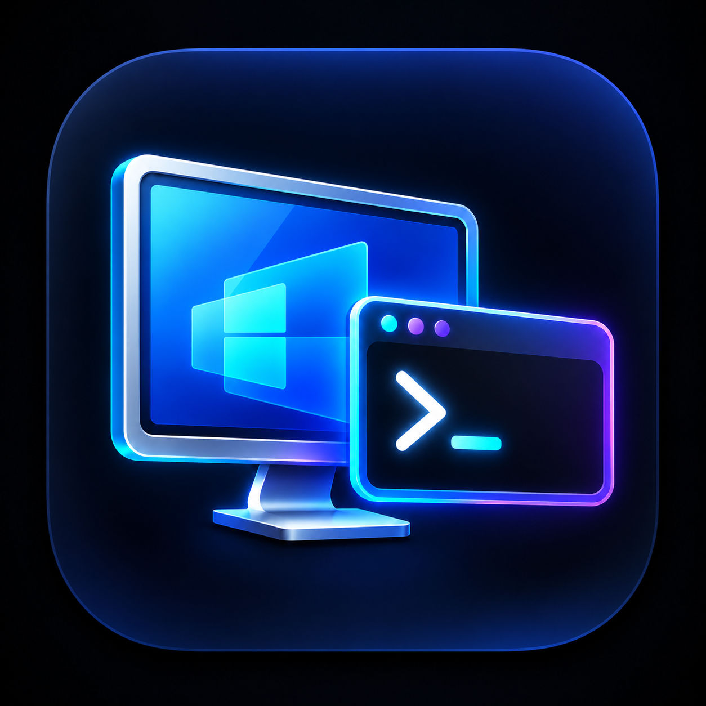

<div align="center">

**English** · [Português (Brasil)](docs/readme/README_pt-BR.md)



# PRDC

### A focused, open-source Remote Desktop connection manager for Windows.

[](https://github.com/pcmbezerra/PRDC/actions/workflows/build.yml)
[](https://dotnet.microsoft.com/)
[](https://www.microsoft.com/windows)
[](LICENSE)

**[Quick start](#quick-start) · [Features](#features) · [Documentation](#documentation) · [Contributing](CONTRIBUTING.md)**

</div>

> [!IMPORTANT]
> The official source for PRDC is [pcmbezerra/PRDC](https://github.com/pcmbezerra/PRDC).
> PRDC is an independent project and is not affiliated with or endorsed by Microsoft.

PRDC organizes Remote Desktop endpoints in RDCMan-compatible `.rdg` files and opens RDP sessions inside a native Windows desktop interface. It uses the Remote Desktop ActiveX control already provided by Windows and does not bundle an RDP implementation.

## Features

- Create, open, edit, and save `.rdg` files.
- Organize servers into nested groups.
- Connect and disconnect one embedded RDP session at a time.
- Show disconnected, connecting, connected, and logged-in states in the server tree.
- Keep a live thumbnail of the active remote session in the details view.
- Resize the remote desktop resolution automatically with the application window.
- Use the native Windows credential and certificate dialogs.
- Enable CredSSP, server authentication, clipboard redirection, and smart sizing.
- Follow the Windows light or dark application theme automatically.
- Preserve unsupported XML elements when editing an existing RDG document.
- Run as a dependency-free .NET desktop application; no external NuGet packages.

## Quick start

### Requirements

- Windows 10 or Windows 11, x64.
- [.NET 10 Desktop Runtime](https://dotnet.microsoft.com/download/dotnet/10.0) to run a built release.
- [.NET 10 SDK](https://dotnet.microsoft.com/download/dotnet/10.0) to build from source.
- Network access and authorization for the target Remote Desktop host.

### Build and run

```powershell
git clone https://github.com/pcmbezerra/PRDC.git
cd PRDC
dotnet restore PRDC.sln
dotnet run --project src/PRDC/PRDC.csproj
```

Create or open an `.rdg` file, select a server, then double-click it or press `Ctrl+Enter`. Disconnect with `Ctrl+Shift+D`.

## RDG compatibility

PRDC implements the file, group, server, display-name, host-name, and expanded-state portions currently needed by the application. Unknown XML elements are retained during load/save, but full behavioral parity with every RDCMan setting is not guaranteed. See [RDG compatibility](docs/rdg-format.md).

Do not commit `.rdg` files containing internal hostnames, usernames, encrypted credentials, or other infrastructure metadata.

## Project structure

```text
PRDC.sln
src/PRDC/
  MainForm.cs       Main window and commands
  RdgDocument.cs    RDG XML persistence
  RdpClientHost.cs  Windows RDP ActiveX host
  NodeDialog.cs     Group and server editor
  AboutDialog.cs    Project and author information
```

The main technical boundaries are documented in [Architecture](docs/architecture.md). Build and validation instructions are in [Development](docs/development.md).

## Documentation

- [Documentation index](docs/index.md)
- [Architecture](docs/architecture.md)
- [Development](docs/development.md)
- [RDG compatibility](docs/rdg-format.md)
- [Security policy](SECURITY.md)
- [Contributing](CONTRIBUTING.md)
- [Changelog](CHANGELOG.md)

## Security and privacy

PRDC does not persist plaintext passwords. Credential prompts are owned by the Windows RDP control. RDG files can still contain sensitive infrastructure metadata; protect them accordingly and report vulnerabilities through the process in [SECURITY.md](SECURITY.md).

## Roadmap

- Multiple simultaneous session tabs.
- Additional RDG connection and display settings.
- RD Gateway configuration.
- Release packaging and signed binaries.

Roadmap items describe intended direction, not committed release dates.

## Contributing

Focused issues and pull requests are welcome. Read [CONTRIBUTING.md](CONTRIBUTING.md) and use the repository templates before submitting a change.

## Origins and independence

PRDC was initially informed by static behavioral analysis of Remote Desktop Connection Manager using [REA](https://github.com/morluto/rea). REA is a development-time analysis tool and is not a runtime dependency. PRDC contains an independent implementation and does not distribute RDCMan or `mstscax.dll`. See [DISCLAIMER.md](DISCLAIMER.md) and [THIRD_PARTY_NOTICES.md](THIRD_PARTY_NOTICES.md).

## License

PRDC is available under the [MIT License](LICENSE).

## Author

[Paulo Bezerra (@pcmbezerra)](https://github.com/pcmbezerra)
