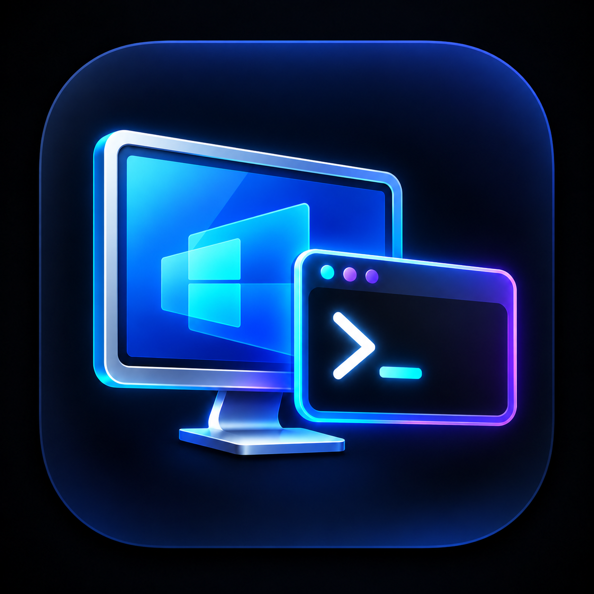

<div align="center">

**English** · [Português (Brasil)](docs/readme/README_pt-BR.md)



# PRDC

### A focused, open-source Remote Desktop connection manager for Windows.

[](https://github.com/pcmbezerra/PRDC/actions/workflows/build.yml)
[](https://dotnet.microsoft.com/)
[](https://www.microsoft.com/windows)
[](LICENSE)

**[Quick start](#quick-start) · [Features](#features) · [Keyboard Shortcuts](#keyboard-shortcuts) · [Documentation](#documentation) · [Contributing](CONTRIBUTING.md)**

</div>

> [!IMPORTANT]
> The official source for PRDC is [pcmbezerra/PRDC](https://github.com/pcmbezerra/PRDC).
> PRDC is an independent project and is not affiliated with or endorsed by Microsoft.

PRDC organizes Remote Desktop endpoints across multiple RDCMan-compatible `.rdg` files and Apache Guacamole portals inside a unified, persistent workspace. Traditional `.rdg` servers connect directly through the Windows Remote Desktop ActiveX control (`mstscax.dll`), while connections from Apache Guacamole portals open in PRDC session tabs via Microsoft Edge WebView2 through the official Guacamole web client and `guacd`.

---

## Features

- **Multi-RDG Workspace:** Open, edit, manage, and save multiple `.rdg` files simultaneously in a single workspace.
- **Multi-Guacamole Integration:** Authenticate against and synchronize multiple Apache Guacamole portals with isolated transactional disk caches under `%LOCALAPPDATA%\PRDC\Portals\`.
- **Persistent Workspace:** Automatically saves open sources, tree state, window bounds, and layout to `%LOCALAPPDATA%\PRDC\workspace.json`. Includes automatic recovery and backup isolation against corrupted files.
- **Global Favorites (`★ Favoritos`):** Pin frequently used servers into a unified top-level root node regardless of their origin (`.rdg` file or Guacamole portal). Supports custom aliases (`F2`), resilient primary and heuristic fallback resolution, and visual orphan status tracking.
- **Global Search & Quick Open (`Ctrl+P`):** High-performance in-memory search index querying tens of thousands of servers in under 3 milliseconds. Features multi-term token matching, favorite scoring boosts, keyboard navigation, direct connection (`Enter`), and jump-to-tree (`Ctrl+Enter`).
- **Hybrid Remote Sessions:**
  - **Native RDP (`mstscax.dll`):** Automatic cascading fallback (MsRdpClient11 down to MsRdpClient6) ensuring compatibility across Windows 10, Windows 11, and Windows Server (2016-2025).
  - **Apache Guacamole (WebView2):** Isolated session tabs powered by `WebView2EnvironmentPool` with automated tunnel health monitoring and dynamic resolution resizing via debounced DOM sensors.
- **Session Isolation (`SessionContext`):** Every remote session maintains immutable context linking back to its originating document or portal.
- **Visual Themes:** Full support for Windows Light, Dark, and System themes, applying dark mode to window chrome, menus, tree views, tabs, and dialogs.
- **Full Screen Mode (`F11`):** Borderless immersive full screen with seamless restoration via `Esc` or `F11`.
- **Session Indicators:** Color-coded status dots (red: disconnected, yellow: connecting, green: active connected session, blue: background connected sessions).

---

## Keyboard Shortcuts

| Shortcut | Description |
| :--- | :--- |
| **`Ctrl+P`** | Open Global Search / Quick Open overlay |
| **`Ctrl+D`** | Toggle Favorite status for the selected server |
| **`Ctrl+G`** | Navigate to the origin document/portal of a favorite |
| **`F2`** | Rename selected item (or set custom alias on a favorite) |
| **`Ctrl+N`** | Create a new `.rdg` document |
| **`Ctrl+O`** | Open an existing `.rdg` file into the workspace |
| **`Ctrl+S`** | Save changes to the active document |
| **`Ctrl+Shift+S`** | Save all open documents in the workspace |
| **`Ctrl+Shift+G`** | Open Apache Guacamole login dialog |
| **`Ctrl+Shift+U`** | Refresh inventory for the selected Guacamole portal |
| **`Ctrl+Shift+D`** | Disconnect active remote desktop session |
| **`F11`** | Toggle Full Screen mode |
| **`Esc`** | Exit Full Screen / Close Quick Open overlay |
| **`Enter`** | (In Quick Open) Connect directly to the selected server |
| **`Ctrl+Enter`** | (In Quick Open or Tree) Focus and navigate to the selected server in the tree |

---

## Quick start

### Requirements

- Windows 10 (1809+) or Windows 11, x64; or Windows Server 2019/2022/2025.
- **Framework-Dependent Release:** Requires [.NET 10.0 Desktop Runtime (x64)](https://dotnet.microsoft.com/download/dotnet/10.0) and Microsoft Edge WebView2 Evergreen Runtime.
- **Self-Contained Release:** Zero .NET dependencies required! Includes complete runtime embedded in a single executable.
- Target Remote Desktop host or Apache Guacamole portal connectivity.

### Build and run from source

```powershell
git clone https://github.com/pcmbezerra/PRDC.git
cd PRDC
dotnet restore PRDC.sln
dotnet run --project src/PRDC/PRDC.csproj
```

---

## Usage Examples

### 1. Working with Multiple Connection Sources
1. Open PRDC. An initial workspace is automatically initialized.
2. Press `Ctrl+O` to open `Production.rdg`.
3. Press `Ctrl+O` again to open `Staging.rdg`. Both files appear as root nodes in the connection tree.
4. Press `Ctrl+Shift+G` to authenticate against your corporate Apache Guacamole portal. The imported hierarchy appears alongside your RDG files.
5. All open sources and window layouts are automatically preserved in `workspace.json` for subsequent launches.

### 2. Using Global Favorites
1. In the tree, select any server from an `.rdg` file or Guacamole portal.
2. Press `Ctrl+D` (or right-click and choose **Adicionar aos Favoritos**).
3. The server appears under the **★ Favoritos** root node.
4. Press `F2` to give the favorite a custom alias (e.g. `Primary Database`).
5. Double-click the favorite or press `Enter` to connect directly with the correct session host.

### 3. Fast Navigation with Quick Open (`Ctrl+P`)
1. Press `Ctrl+P` from anywhere in the application.
2. Type partial names or groups, e.g., `banco prod` or `bastion cloud`.
3. Use the `Up` and `Down` arrow keys to navigate the ranked results.
4. Press `Enter` to connect immediately, or press `Ctrl+Enter` to locate and select the server in the connection tree.

---

## Project Structure

```text
PRDC.sln
src/PRDC/
  MainForm.cs                      Main window, menus, tree orchestration and session tabs
  IConnectionSource.cs             Abstraction contract for connection sources
  RdgFileSource.cs                 RDCMan .rdg source implementation
  GuacamoleInventorySource.cs      Apache Guacamole source implementation
  WorkspaceManager.cs              Atomic workspace persistence and crash recovery
  FavoriteManager.cs               Global favorites engine and orphan detection
  FavoriteEntry.cs                 Favorite model with primary & fallback locators
  SearchCatalogManager.cs          High-performance global search index and ranking
  QuickOpenOverlayForm.cs          Floating quick open (Ctrl+P) modal overlay
  SessionContext.cs                Immutable session-to-source context isolation
  WebView2EnvironmentPool.cs       Shared pool of CoreWebView2Environment instances
  GuacamolePortalManager.cs        Multi-portal metadata and cache manager
  GuacamoleInventoryCache.cs       Atomic cache manager for Apache Guacamole inventory
  RdgDocument.cs                   RDG XML document manipulation
  RdpClientHost.cs                 Windows RDP ActiveX host with fallback cascade
  GuacamoleSessionHost.cs          WebView2 host for Apache Guacamole sessions
  ThemeManager.cs                  Light/Dark/System theme orchestration
```

---

## Documentation

- [User Guide](docs/user-guide.md)
- [Architecture](docs/architecture.md)
- [Development](docs/development.md)
- [RDG Format Compatibility](docs/rdg-format.md)
- [Security Policy](SECURITY.md)
- [Contributing](CONTRIBUTING.md)
- [Changelog](CHANGELOG.md)

---

## License

PRDC is available under the [MIT License](LICENSE).

## Author

[Paulo Bezerra (@pcmbezerra)](https://github.com/pcmbezerra)
