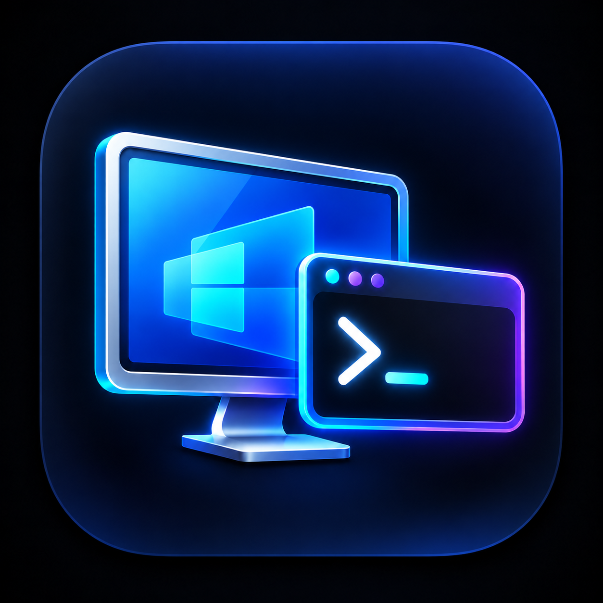

<div align="center">

[English](../../README.md) · **Português (Brasil)**



# PRDC

### Gerenciador open source de conexões de Área de Trabalho Remota para Windows.

[](https://github.com/pcmbezerra/PRDC/actions/workflows/build.yml)
[](https://dotnet.microsoft.com/)
[](https://www.microsoft.com/windows)
[](../../LICENSE)

**[Início rápido](#início-rápido) · [Funcionalidades](#funcionalidades) · [Atalhos de Teclado](#atalhos-de-teclado) · [Documentação](#documentação) · [Como contribuir](../../CONTRIBUTING.md)**

</div>

> [!IMPORTANT]
> A fonte oficial do PRDC é [pcmbezerra/PRDC](https://github.com/pcmbezerra/PRDC).
> O PRDC é um projeto independente, sem afiliação ou endosso da Microsoft.

O PRDC organiza endpoints de Área de Trabalho Remota distribuídos em múltiplos arquivos `.rdg` (compatíveis com o RDCMan) e portais Apache Guacamole dentro de um workspace persistente unificado. Conexões `.rdg` tradicionais utilizam diretamente o controle ActiveX de Área de Trabalho Remota do Windows (`mstscax.dll`), enquanto conexões importadas de portais Apache Guacamole são abertas em abas de sessão do PRDC via Microsoft Edge WebView2 através do cliente web oficial do Guacamole e `guacd`.

---

## Funcionalidades

- **Workspace Multi-RDG:** Abra, edite, gerencie e salve múltiplos arquivos `.rdg` simultaneamente na mesma janela.
- **Integração Multi-Guacamole:** Autenticação e sincronização com múltiplos portais Apache Guacamole com cache transacional isolado no disco em `%LOCALAPPDATA%\PRDC\Portals\`.
- **Workspace Persistente:** Gravação e restauração automática de origens abertas, estado da árvore, limites da janela e layout em `%LOCALAPPDATA%\PRDC\workspace.json`. Inclui recuperação tolerante a falhas com isolamento de backups de arquivos corrompidos.
- **Favoritos Globais (`★ Favoritos`):** Coleção unificada de servidores prioritários no topo da árvore, independentemente da origem (`.rdg` ou portal Guacamole). Permite definir apelidos personalizados (`F2`), resolução heurística resiliente e sinalização visual de conexões órfãs.
- **Busca Global e Quick Open (`Ctrl+P`):** Motor de indexação em memória de altíssimo desempenho capaz de pesquisar dezenas de milhares de servidores em menos de 3 milissegundos. Suporta buscas multitermo, bônus de relevância para favoritos, navegação por teclado, conexão direta (`Enter`) e navegação na árvore (`Ctrl+Enter`).
- **Sessões Remotas Híbridas:**
  - **RDP Nativo (`mstscax.dll`):** Resolução dinâmica em cascata (MsRdpClient11 até MsRdpClient6) garantindo compatibilidade no Windows 10, Windows 11 e Windows Server (2016-2025).
  - **Apache Guacamole (WebView2):** Abas de sessão isoladas gerenciadas por `WebView2EnvironmentPool`, monitoramento de saúde do túnel e redimensionamento dinâmico de resolução via sensores DOM nativos.
- **Isolamento de Contexto (`SessionContext`):** Cada sessão aberta preserva o vínculo imutável com sua respectiva origem ou portal.
- **Temas Visuais:** Suporte integral aos temas Claro, Escuro e do Sistema do Windows, estendendo o Dark Mode para menus, árvore de navegação, abas e diálogos.
- **Modo Tela Cheia (`F11`):** Visualização imersiva sem bordas com retorno transparente via `Esc` ou `F11`.
- **Indicadores de Estado:** Indicadores coloridos por ponto (vermelho: desconectado, amarelo: conectando, verde: sessão ativa conectada, azul: sessões conectadas em segundo plano).

---

## Atalhos de Teclado

| Atalho | Descrição |
| :--- | :--- |
| **`Ctrl+P`** | Abrir Busca Global / Quick Open |
| **`Ctrl+D`** | Adicionar/remover servidor selecionado dos Favoritos |
| **`Ctrl+G`** | Navegar até a origem do favorito selecionado |
| **`F2`** | Renomear item selecionado (ou definir apelido para favorito) |
| **`Ctrl+N`** | Criar um novo arquivo `.rdg` |
| **`Ctrl+O`** | Abrir um arquivo `.rdg` existente no workspace |
| **`Ctrl+S`** | Salvar alterações no documento ativo |
| **`Ctrl+Shift+S`** | Salvar todos os documentos abertos no workspace |
| **`Ctrl+Shift+G`** | Abrir diálogo de login do Apache Guacamole |
| **`Ctrl+Shift+U`** | Atualizar inventário do portal Guacamole selecionado |
| **`Ctrl+Shift+D`** | Desconectar a sessão remota ativa |
| **`F11`** | Alternar modo Tela Cheia |
| **`Esc`** | Sair de Tela Cheia / Fechar o Quick Open |
| **`Enter`** | (No Quick Open) Conectar diretamente ao servidor selecionado |
| **`Ctrl+Enter`** | (No Quick Open ou Árvore) Focar e selecionar o servidor na árvore |

---

## Início rápido

### Requisitos

- Windows 10 (1809+) ou Windows 11 x64; ou Windows Server 2019/2022/2025.
- **Pacote Framework-Dependent:** Requer [.NET 10.0 Desktop Runtime (x64)](https://dotnet.microsoft.com/download/dotnet/10.0) e Microsoft Edge WebView2 Evergreen Runtime.
- **Pacote Self-Contained:** Nenhuma dependência de .NET necessária! Runtime completo embutido em executável único.
- Acesso de rede e autorização para o servidor RDP de destino ou portal Apache Guacamole.

### Compilar e executar a partir do código-fonte

```powershell
git clone https://github.com/pcmbezerra/PRDC.git
cd PRDC
dotnet restore PRDC.sln
dotnet run --project src/PRDC/PRDC.csproj
```

---

## Exemplos de Uso

### 1. Trabalhando com Múltiplas Origens
1. Abra o PRDC. O workspace persistente é inicializado automaticamente.
2. Pressione `Ctrl+O` e selecione `Produção.rdg`.
3. Pressione `Ctrl+O` novamente e selecione `Homologação.rdg`. Os dois arquivos passam a coexistir como nós raiz na árvore.
4. Pressione `Ctrl+Shift+G` e informe as credenciais do seu portal Apache Guacamole corporativo. O inventário é adicionado como uma origem independente.
5. Ao fechar o PRDC, todo o conjunto de origens e posições de janela são salvos atomicamente em `workspace.json`.

### 2. Gerenciando Favoritos Globais
1. Na árvore de conexões, selecione qualquer servidor de um arquivo RDG ou portal Guacamole.
2. Pressione `Ctrl+D` (ou clique com botão direito e escolha **Adicionar aos Favoritos**).
3. O servidor é referenciado no nó raiz **★ Favoritos**.
4. Pressione `F2` para atribuir um apelido amigável (ex.: `Banco Primário de Produção`).
5. Dê duplo clique no favorito para abrir a sessão remota diretamente no host correto.

### 3. Navegação Rápida com Quick Open (`Ctrl+P`)
1. Pressione `Ctrl+P` em qualquer momento.
2. Digite termos parciais, como `banco prod` ou `bastion cloud`.
3. Navegue entre os resultados ranqueados utilizando as setas do teclado.
4. Pressione `Enter` para conectar imediatamente ou `Ctrl+Enter` para localizar o nó correspondente na árvore.

---

## Documentação

- [Guia do Usuário](../user-guide.md)
- [Arquitetura](../architecture.md)
- [Desenvolvimento](../development.md)
- [Compatibilidade RDG](../rdg-format.md)
- [Política de Segurança](../../SECURITY.md)
- [Como Contribuir](../../CONTRIBUTING.md)
- [Changelog](../../CHANGELOG.md)

---

## Licença

O PRDC é distribuído sob os termos da [Licença MIT](../../LICENSE).

## Autor

[Paulo Bezerra (@pcmbezerra)](https://github.com/pcmbezerra)
